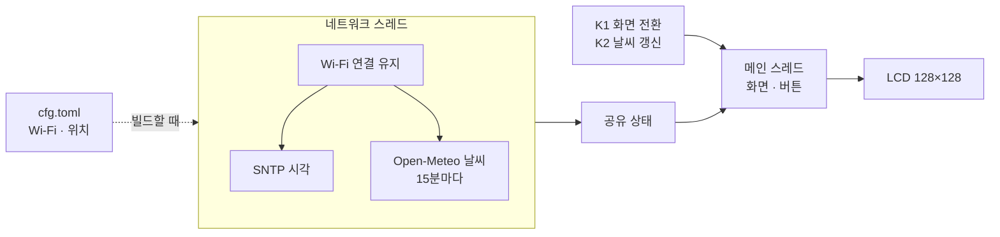

# esp32c3-lcd144-keychain

Spotpear ESP32-C3 1.44" LCD 키링(ST7735S 128×128, 16MB 플래시, 리튬 배터리, 버튼 2개)용 커스텀 펌웨어.

Wi-Fi로 시각과 날씨를 받아 보여 주는 작은 시계입니다. 시각은 SNTP로 맞추고, 날씨는 [Open-Meteo](https://open-meteo.com/)에서 15분마다 받습니다.



## 빠른 시작

1. `firmware/cfg.toml.example`을 `firmware/cfg.toml`로 복사하고 Wi-Fi 이름·비밀번호와 위치(위도·경도)를 채웁니다. 커밋되지 않는 파일입니다.
2. `cd firmware && cargo run`으로 빌드해서 올립니다.

USB 단자를 아래로 두고 보면 위에 날짜·요일, 가운데에 시각, 아래에 날씨가 나옵니다. **K1**은 날씨 자세히 화면으로 바꾸고, **K2**는 날씨를 바로 다시 받습니다. 자세한 내용은 **[사용법 문서](docs/usage.md)** 에 있습니다.

## 직접 빌드하기

```bash
cd firmware && cargo run
```

`cargo install ldproxy espflash`가 선행되어야 하며, 첫 빌드는 ESP-IDF를 내려받느라 오래 걸립니다. USB 케이블 하나로 플래시와 시리얼 모니터가 모두 됩니다 (`/dev/cu.usbmodem*`). Wi-Fi 설정은 빌드할 때 펌웨어에 들어가므로 `cfg.toml`을 바꾸면 다시 빌드해서 올립니다.

플래시가 잘 안 되면 BOOT를 누른 채 RESET을 눌렀다 떼어 다운로드 모드로 들어간 뒤 다시 시도합니다.

펌웨어 버전은 `firmware/Cargo.toml`을 따르고, 부팅 로그와 하드웨어 점검 화면에 `0.1.0+<커밋>` 형태로 찍힙니다.

## 문서

| 문서 | 내용 |
|---|---|
| [사용법](docs/usage.md) | 처음 설정, 화면, 버튼, 하드웨어 점검 모드 |
| [하드웨어](docs/hardware.md) | 사양, 핀맵, LCD·전원 회로, 처음 받았을 때의 상태 |

## 기술 스택

- **Rust std (ESP-IDF)**: [esp-idf-svc](https://github.com/esp-rs/esp-idf-svc) 기반. Wi-Fi, SNTP, HTTPS 클라이언트
- **[mipidsi](https://github.com/almindor/mipidsi)**: ST7735S LCD 드라이버 (이 패널용 모델은 `firmware/src/lcd.rs`)
- **[embedded-graphics](https://github.com/embedded-graphics/embedded-graphics) + [u8g2-fonts](https://github.com/Finomnis/u8g2-fonts)**: 도형, 큰 숫자 글꼴
- **[Open-Meteo](https://open-meteo.com/)**: 날씨 API (키 불필요). 응답은 serde_json으로 읽는다
- **[toml-cfg](https://github.com/jamesmunns/toml-cfg)**: 빌드할 때 `cfg.toml` 설정 읽기

## 프로젝트 구조

```
.
├── docs/                    # 문서 (위 표 참고)
├── .github/workflows/ci.yml # push/PR 검증 (fmt + release build + clippy)
└── firmware/                # Rust 펌웨어 (cargo 프로젝트 루트, 빌드는 여기서)
    ├── .cargo/config.toml   # 타겟, 링커, 러너, ESP-IDF 버전 고정
    ├── rust-toolchain.toml  # nightly 고정 + 컴포넌트
    ├── sdkconfig.defaults   # ESP-IDF 설정
    ├── build.rs             # 펌웨어 버전 문자열 (FW_VERSION)
    ├── cfg.toml.example     # Wi-Fi·위치 설정 예시 (cfg.toml로 복사, 커밋하지 않음)
    └── src/
        ├── main.rs          # 초기화 + 화면·버튼 메인 루프
        ├── net.rs           # 네트워크 스레드: Wi-Fi, SNTP, 날씨 주기 갱신
        ├── weather.rs       # Open-Meteo 조회, WMO 날씨 코드
        ├── clock.rs         # UTC → 한국 표준시
        ├── ui.rs            # 프레임버퍼, 시계·날씨 화면, 아이콘
        ├── button.rs        # 버튼 디바운스
        ├── config.rs        # cfg.toml 설정 (toml-cfg)
        ├── lcd.rs           # 1.44" ST7735S 패널 모델 (초기화 값, 메모리 크기)
        └── bringup.rs       # 하드웨어 점검 모드 (K2를 누른 채 켜기)
```

## 로드맵

작업은 [GitHub 이슈](https://github.com/barmi/esp32c3-lcd144-keychain/issues) 단위로 진행합니다.

| 단계 | 내용 | 상태 |
|---|---|---|
| 1 | 개발 환경 구축 및 하드웨어 점검 펌웨어 ([#1](https://github.com/barmi/esp32c3-lcd144-keychain/issues/1)) | 완료 |
| 2 | Wi-Fi 시계·날씨 앱 ([#3](https://github.com/barmi/esp32c3-lcd144-keychain/issues/3)) | 완료 |
